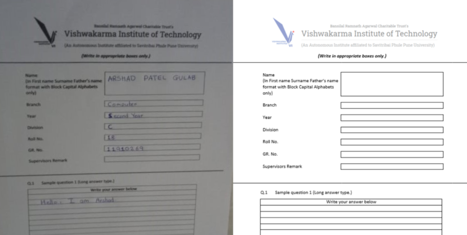
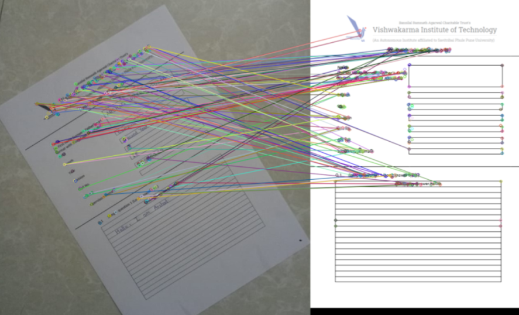
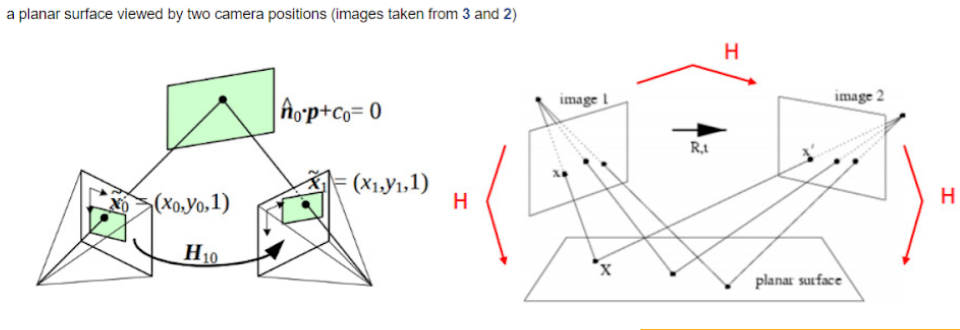
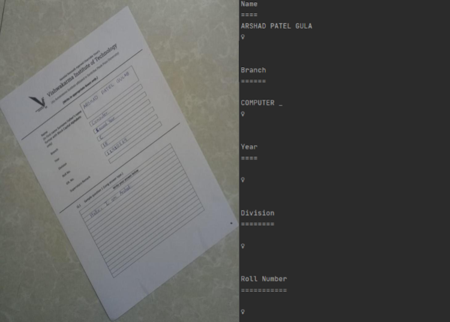
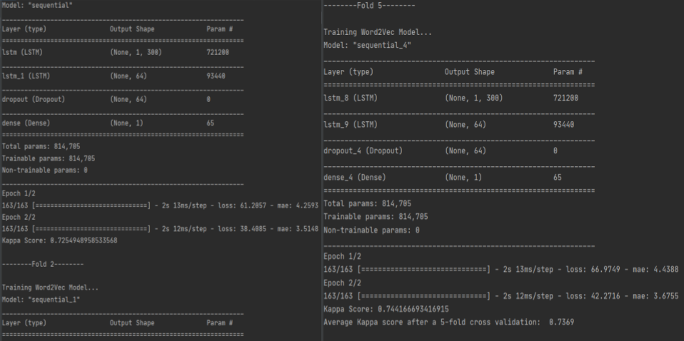
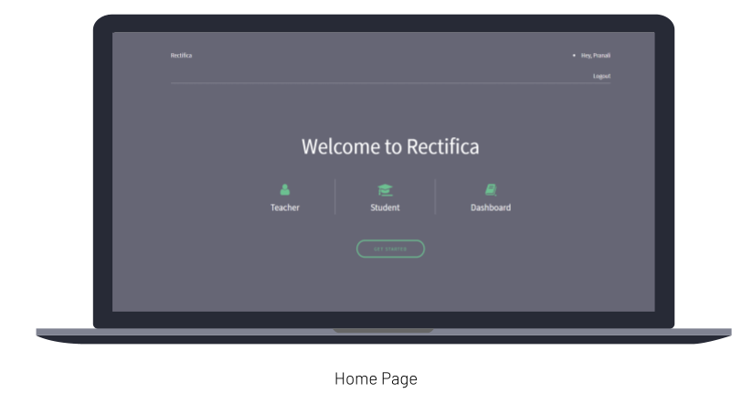
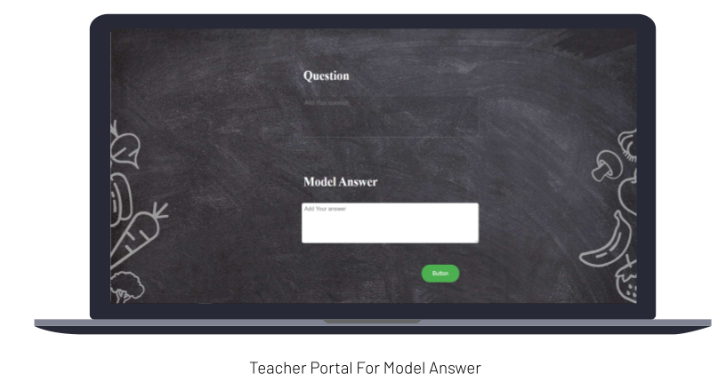
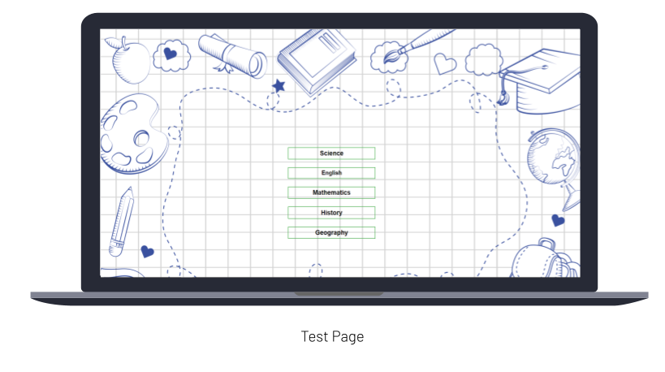
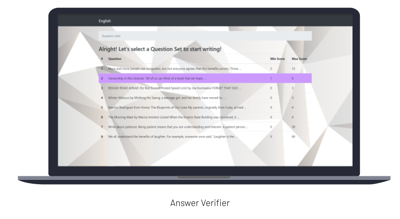

# Description
Rectifica is fully feature integrated application that could help the education system improve by making use of technology to automate subjective answer evaluation. The goal is to get image snapshots of subjective answers or to get the answers through a website. The Images then will be converted to text using OCR and this text answer will be graded based on model answer provided by Teacher/Professor based on custom word embedding models based LSTM model that has the capability to give good accuracy and good results. Another integrated feature would be to add video conferencing capabilities so that rectifica would be one stop solution for teaching and grading.

# Motivation
During the quarantine period of covid, learning was mostly remote and through online mediums, this motivated us to have a solution to video conferencing needs and grading examinations in automated and faster way.

# Features
1. Grading subjective answers using deep learning algorithms.
2. Schedule meeting for teachers and students.

# Tech Stack
1. Django
2. Javascript
3. Postgres
4. Agora

# Images

